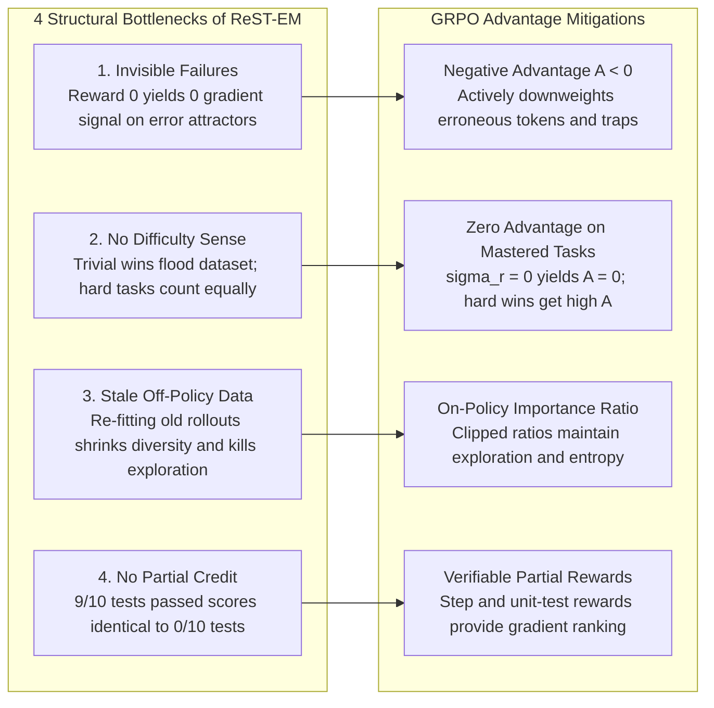
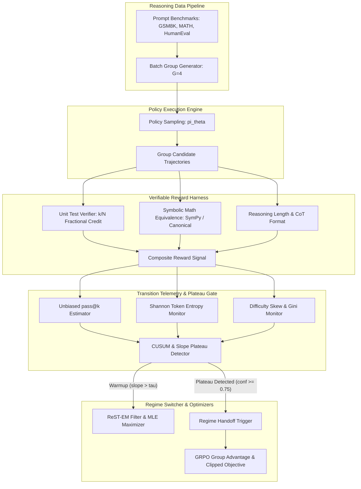
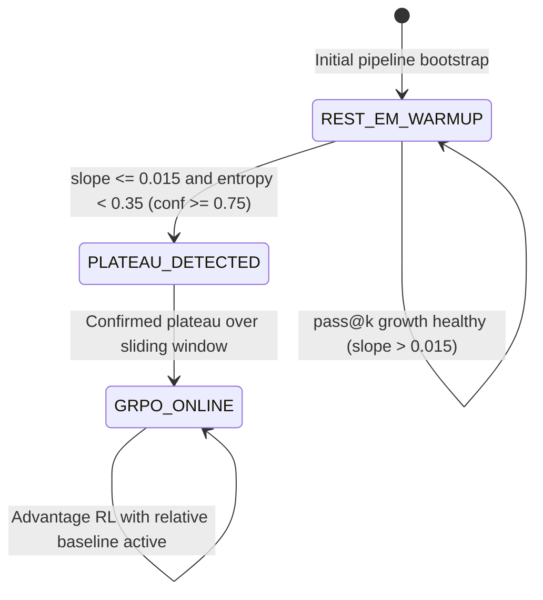

# System Architecture Blueprint: ReST-EM vs. Group Relative Policy Optimization

## 1. Executive Problem Statement and Theoretical Foundation

When post-training Large Language Models (LLMs) on verifiable reasoning tasks (mathematics, formal code generation, symbolic logic), engineering teams face a fundamental regime decision: **Rejection Sampling Fine-Tuning (ReST-EM / Best-of-N Filtered SFT)** versus **Online Advantage Reinforcement Learning (Group Relative Policy Optimization / GRPO)**.

A common industry misconception assumes that rejection sampling filtering operates identically to reinforcement learning. This assumption is mathematically false.

```mermaid
flowchart TD
    subgraph SFT_Filtering["ReST-EM: Rejection Sampling (Positive-Only Filter)"]
        direction TB
        P1[Prompt x] --> S1[Sample N Rollouts]
        S1 --> V1{Verifier Check r=1}
        V1 -- "Pass (r=1)" --> D_acc[Accepted Dataset]
        V1 -- "Fail (r=0)" --> D_disc[Discarded / Silent]
        D_acc --> MLE[MLE Supervised Loss: -log P(y|x)]
        MLE --> Up1[Policy Update: Learn from what went right]
    end

    subgraph RL_Advantage["GRPO: Group Relative Policy Optimization"]
        direction TB
        P2[Prompt x] --> S2[Sample G Rollouts in Group]
        S2 --> V2[Verifier Feedback: Binary or Partial]
        V2 --> G_Base["Group Baseline: Mean r_bar, Std sigma_r"]
        G_Base --> ADV["Advantage: A_i = (r_i - r_bar) / (sigma_r + eps)"]
        ADV --> G_Update["Clipped Surrogate + Negative Error Penalty"]
        G_Update --> Up2[Policy Update: Learn from relative surprise]
    end
```

---

## 2. Mathematical Formalization

### 2.1 ReST-EM as REINFORCE Without a Baseline

In ReST-EM, given a dataset of prompts $\mathcal{D}$ and a reference policy $\pi_\theta$, rollouts $y \sim \pi_{\theta_{\text{old}}}(y|x)$ are filtered against a binary verifier $r(x, y) \in \{0, 1\}$. The optimization objective is maximum likelihood on the filtered subset:

$$\mathcal{J}_{\text{ReST}}(\theta) = \mathbb{E}_{x \sim \mathcal{D}, y \sim \pi_{\theta_{\text{old}}}} \left[ \mathbf{1}(r(x, y) = 1) \log \pi_\theta(y | x) \right]$$

Computing the policy gradient reveals its direct equivalence to REINFORCE with $R=1$ for accepted rollouts and a zero baseline $b(x) = 0$:

$$\nabla_\theta \mathcal{J}_{\text{ReST}}(\theta) = \mathbb{E}_{x, y} \left[ \mathbf{1}(r(x, y) = 1) \nabla_\theta \log \pi_\theta(y | x) \right]$$

This formulation confirms that ReST-EM optimizes strictly on positive demonstrations, ignoring the distribution of negative trajectories entirely.

### 2.2 Group Relative Policy Optimization (GRPO)

GRPO eliminates critic and value networks by generating a group of $G$ candidate trajectories $\{y_1, y_2, \dots, y_G\}$ for each prompt $x$. The empirical group mean $\bar{r}(x)$ and group standard deviation $\sigma_r(x)$ form a relative baseline:

$$\bar{r}(x) = \frac{1}{G} \sum_{i=1}^G r(x, y_i), \quad \sigma_r(x) = \sqrt{\frac{1}{G} \sum_{i=1}^G (r(x, y_i) - \bar{r}(x))^2}$$

The normalized advantage $A_i$ represents relative surprise:

$$A_i = \frac{r(x, y_i) - \bar{r}(x)}{\sigma_r(x) + \epsilon}$$

The clipped surrogate objective is defined as:

$$\mathcal{J}_{\text{GRPO}}(\theta) = \mathbb{E}_{x, \{y_i\}_{i=1}^G} \left[ \frac{1}{G} \sum_{i=1}^G \min\left( \frac{\pi_\theta(y_i|x)}{\pi_{\theta_{\text{old}}}(y_i|x)} A_i, \text{clip}\left(\frac{\pi_\theta(y_i|x)}{\pi_{\theta_{\text{old}}}(y_i|x)}, 1-\epsilon, 1+\epsilon\right) A_i \right) - \beta D_{KL}(\pi_\theta || \pi_{\text{ref}}) \right]$$

---

## 3. The Four Structural Failure Modes of Rejection Sampling



### Failure Mode 1: Invisible Failures
- **Problem**: When a candidate rollout fails ($r(x, y) = 0$), ReST-EM discards it. The model receives zero gradient direction informing it of syntax errors, infinite recursion traps, or arithmetic miscalculations.
- **GRPO Resolution**: When $G-1$ rollouts succeed and 1 fails on an easy problem, $\bar{r} \to 1.0$. The single failure receives large negative advantage $A_{\text{fail}} = -\sqrt{G-1}$, downweighting toxic tokens.

### Failure Mode 2: No Difficulty Sense
- **Problem**: For an easy prompt where all $N=64$ rollouts pass, ReST-EM adds all 64 instances to the training buffer. For a hard prompt where only 1 rollout passes, only 1 instance is added. Easy mastered tasks dominate gradient updates, creating severe difficulty skew.
- **GRPO Resolution**: When all rollouts pass ($r_i = 1 \ \forall i$), group variance is zero ($\sigma_r = 0$), yielding $A_i = 0$. Zero gradient update is applied to mastered problems. Conversely, a rare win on a hard problem achieves $A_i = +\sqrt{G-1}$.

### Failure Mode 3: Stale Off-Policy Data and Entropy Collapse
- **Problem**: Re-fitting historical positive rollouts over multiple iterations contracts policy entropy $\mathcal{H}(\pi_\theta)$ toward narrow modes, eliminating exploration of alternative reasoning paths.
- **GRPO Resolution**: Bounded importance sampling ratios and explicit KL divergence regularization ($D_{KL}(\pi_\theta || \pi_{\text{ref}})$) preserve exploration capacity.

### Failure Mode 4: No Partial Credit
- **Problem**: A candidate passing 9 out of 10 unit tests receives binary score $0$, treated identically to complete failure ($0/10$). High-signal near-miss reasoning trajectories are lost.
- **GRPO Resolution**: Continuous fractional rewards $r \in [0.0, 1.0]$ enable relative group ranking, rewarding progressive refinements.

---

## 4. Subsystem Dataflow Blueprint



---

## 5. Transition Gate State Machine

The transition gate governs the automated handoff between regimes:


